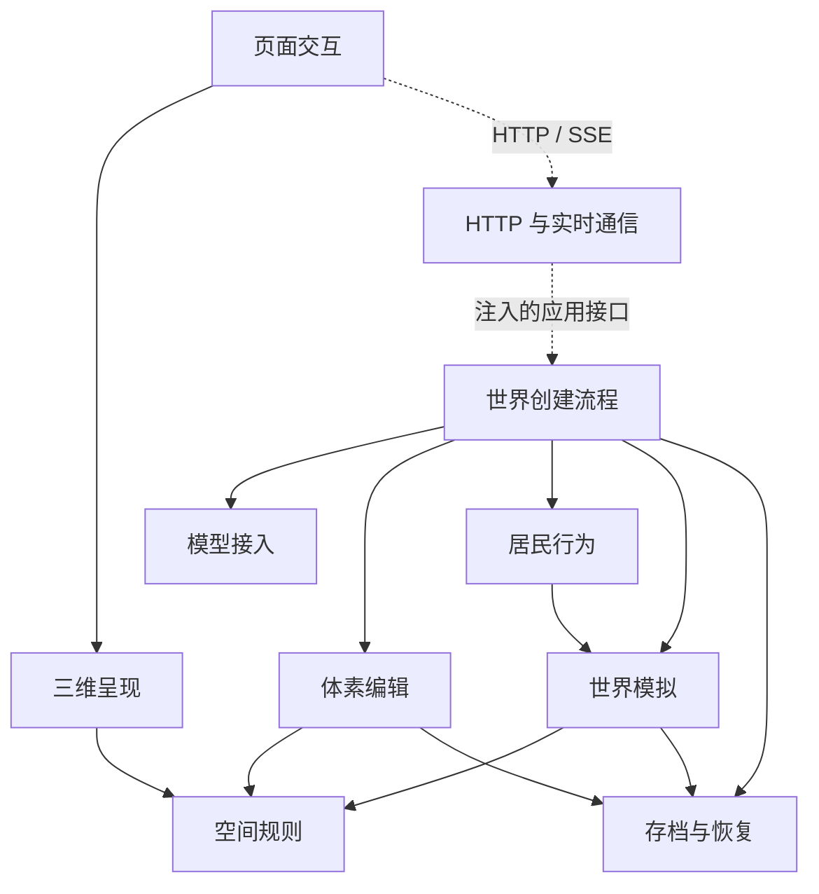

# 原型架构

核对日期：2026-11-05。本文描述当前实现；产品目标见[项目意图](intent.md)，安装与使用见[README](../README.md)。

## 十个模块

项目保持单仓库、单服务。`server.mjs` 是装配与启动入口，继续导出原有的三个工厂函数；业务代码按职责放进下面十个目录。目录之间的依赖由 `tests/module-boundaries.test.mjs` 检查。

| 模块 | 入口与职责 | 允许依赖的其他模块 |
| --- | --- | --- |
| `ui/` 页面交互 | `app.js` 管理页面状态与操作；`transport.js` 负责浏览器请求、事件订阅和回复流解析 | rendering、spatial、residents 的地点摘要 |
| `rendering/` 三维呈现 | `scene.js`、`world-scene.js`、`voxel-scene.js` 管理画面、相机与释放；`scene-compiler.js` 编译几何；`scene-check.mjs` 封装候选编译检查与清理 | spatial |
| `transport/` HTTP 与实时通信 | `http-server.mjs` 接收注入的应用实例，处理 API、SSE、请求边界；`assets.mjs` 维护浏览器文件白名单 | 无业务模块 |
| `creation/` 世界创建流程 | `index.mjs` 装配应用；`world-creation.mjs` 协调讨论、建造与起点确认；`world-runtime.mjs` 调度运行中的世界；`recovery.mjs` 恢复中断的创建 | simulation、residents、model、voxel、spatial、rendering、storage |
| `voxel/` 体素编辑 | `voxel-world.mjs` 管理事务与撤销／重做；`voxel-tools.mjs`、`creation-attempt.mjs` 校验命令；`context.mjs` 投影模型可读的当前场景 | spatial、storage |
| `spatial/` 空间规则 | 场景数据契约、空间诊断、局部修复命令与世界地点绑定；不加载 Three.js | 无 |
| `simulation/` 世界模拟 | `core.mjs` 推进时间与提交状态；`world-definition.mjs` 定义规则和行动效果；`activity.mjs` 投影已提交的变化 | spatial、storage |
| `residents/` 居民行为 | `actor.mjs` 管理观察、信息隔离、记忆及行动提议校验；地点摘要单独供页面使用 | simulation |
| `model/` 模型接入 | 配置、协议适配、响应流、生成结果解析、素材检索与审计摘要 | 无业务模块 |
| `storage/` 存档与恢复 | `files.mjs` 负责原子 JSON 替换与审计写入；`world-repository.mjs` 管理创建存档、旧实验迁移和世界归档 | 无 |

图中虚线表示通信或装配关系；HTTP 模块不导入创建模块。完整允许依赖见表格，跨模块循环会使验证失败。浏览器依赖另做递归检查，确保不会意外加载 Node.js 模块；空间和模拟代码不能反向导入渲染器。新增浏览器文件必须加入显式白名单，配置和存档不会通过静态路由公开。

## 数据流

创建按“作者意图 → 模型候选 → 程序校验 → 保存 → 画面”推进。讨论不执行建造；自动建造读取每轮最新体素与诊断，先处理可确定的局部修复，再按需请求模型。命令数、轮次和请求时限集中在 `creation-limits.mjs`。失败或中断保留已提交结果，刷新或重启不会自动请求模型。

确认起点后，角色根据自身可见信息提出行动，由模拟器验证并提交后果。作者界面可查看全局状态，角色输入受信息边界限制。创建、预览与运行使用已保存的同一体素内容；人物只有在找到安全支撑面和净空时才显示实体，否则显示地点级状态。

## 配置与存档

`model/config.mjs` 从进程环境变量或 `.env` 读取配置，环境变量优先；`WISPIVA_ENV_FILE` 可指定配置文件。字段见 [`.env.example`](../.env.example)。客户端支持 Responses、Chat Completions 和 Anthropic Messages，兼容性需按实际端点验证。

`.data/prototype/` 保存创建过程、世界状态与归档，现有文件名和版本保持兼容。体素、对象归属、撤销／重做历史和对话结果一起写入 `creation.json` 的 `voxelSnapshot`，文件替换成功后才更新内存；旧独立体素文件仍可迁移。文件操作集中在 `storage/`，领域模块保留数据校验与提交顺序。损坏或不支持的创建存档会阻止启动并保留原文件。运行状态与创建状态分文件保存，不具备跨文件事务。

页面关闭后，仍在运行的服务可以继续推进世界；服务退出时冻结，重启不补算离线时间。完整历史仍驻留内存并整体写入文件，长期容量和断电耐久性尚未验证。

## 验证入口与边界

| 入口 | 范围 |
| --- | --- |
| `npm run check` | 检查十个模块与启动入口的 JavaScript 语法，自动发现并串行运行 `tests/*.test.mjs`、`tests/observe-*.mjs`、`model/observe-*.mjs`；覆盖模块依赖、浏览器依赖链、HTTP 文件边界和存档失败；使用合成模型，不读取私有配置、不调用真实模型、不启动浏览器 |
| `npm run benchmark:voxel` | 756 与 5,000 方块样本的上下文大小、快照大小、重载数量及总耗时 |
| `npm run soak:simulation` | 1–14 个模拟日的合成世界与进程重启检查 |
| `.github/workflows/prototype-preview.yml` | 离线检查与合成模型浏览器流程 |
| `.github/workflows/live-model-loop.yml` | 使用仓库配置验证真实模型建造与修复回路 |
| `.github/workflows/prototype-soak.yml` | 云端运行合成世界 soak，只上传指标 |

当前模拟只覆盖有限地点、资源、条件过程和角色信息隔离。空间诊断只检查受支持的单层矩形建筑；隐私审计只能拦截部分泄漏。检查通过不能证明任意建筑可通行、自然语言推理安全或视觉体验合格。复杂物理、大型世界、连续寻路、长期主观记忆与自由分岔尚未完成或验证。
