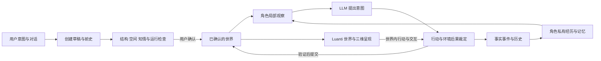

# Wispiva 产品目标实现路线

更新：2026-11-05。本文描述本分支的**目标设计**，不是当前实现。本 worktree 以 Wispiva 独立产品为目标，采用 Minecraft-like 的 Luanti 基底实现这一目标；产品模块位于仓库根目录，Luanti 只承担引擎适配。本分支独立发展，不合并到 `main`。共同产品目标以[项目意图](../intent.md)为准；现状见[当前架构](../architecture.md)，阶段与验收见[实施计划](../PLAN.md)。

## 范围与路线

从用户的一句想法或提供的素材出发，对话、构建并确认一个世界；用户可在三维世界中观察、与角色互动、离开后回来查看变化。角色依据自身观察、目标和经历自主行动，环境有独立过程与可追踪后果，世界能够持续、保存、恢复和演化。第一用户仍是作者本人；世界不必须以角色、社会实验或预设剧情为中心。

本分支选 Luanti 提供 Minecraft-like 的空间、方块、客户端、实体和世界运行底座。服务端实体是目前已接受的角色形态；它们不是客户端玩家，也没有真实第一人称视觉。未来附身和面向网页的产品入口仍是共同目标，如何接入须专门设计与验证。原型分支的世界创建、行为边界和 3D 经验可借鉴或按许可及接口择取，既不要求整体合并，也不意味着改变主分支的技术路线。

## 目标流程与权威边界

图为目标职责关系。Luanti 地图、对象和位置与模拟所依据的事实必须一致；界面、角色描述和模型输出不能各自成为另一套真相。具体采用 Luanti 世界作为空间权威还是经可靠适配与协调的其他权威存储，尚须在首个纵向闭环中通过恢复、一致性和失败注入验证后确定；不能假设跨进程操作天然具有原子性。玩家或模型提出的变化均走同一条受验证的世界写入路径，操作失败或投影不一致必须可检测、可恢复，不能作为成功事实显示。没有确定可靠的提交和恢复协议前，不声称通用原子事务已经实现。

角色选择意图，环境裁定条件和后果：资源、时间、位置和世界规律可检查，不能把尝试直接当成功。环境自身过程亦可改变世界。规则和技能可以承担寻路及动作执行，但不以固定脚本替代角色的 LLM 决策；角色可能暂停、等待或失败。推演结果在基准、约束和依赖通过检查并提交后才是事实，过期结果不可覆盖新状态。涉及模型推演的语义正确性不是结构检查或模型自评能够保证的。

## 创建与空间

创建流程从用户想法形成可编辑草稿：范围、地点及连接、角色、关系、已知／未知、前史、资源和世界规律；用受限的建筑蓝图和工具构造可进入空间，验证对象身份、尺寸、连通、可行动空间和角色起点。用户确认之前不覆盖已有世界。生成不成功明确报错，不能用固定故事替代。

场景构造不以参考图片为前提。图片可以作为补充视觉约束；没有图片时，应从用户描述、原作文字和角色已有设定中提取地点用途、活动需求、时代与风格线索、空间关系及确定事实，并把文本明确的信息与设计推断分别记录。先生成可编辑的结构化空间方案（区域、尺寸、入口与窗、对象用途和位置、材料与光线），再由可组合的建筑规则和资产投影为 Luanti 场景。蓝图和资产是构造语法，不应成为题材与空间变化的上限。

构造结果要验证尺度、碰撞、连通、可行走路径、角色起点及与世界设定的一致性；将实际引擎画面作为反馈，允许有界修订。缺少依据的装饰细节可以作为明确的设计推断供用户编辑，不能把推断伪装成原作事实。参考图是可选输入或验收对照，不是运行时依赖。

当前实现覆盖其中一个受限切片：Genesis schema v2 允许纯文本意图生成固定 11×9 室内、三套现有节点配色和至多八件墙边家具；家具附有 `stated/inferred/author` 分类，编译器与 Lua 校验布局、占位和角色起点。投影有固定顶灯和会避开高书架的壁灯，尚无可编辑灯光方案。Actions [41825285114](https://github.com/kikoiio/Wispiva/actions/runs/41825285114) 已用真实 provider 从无参考图的文字生成书房和工作室，两份草稿通过编译与发布检查，书房通过真实 Luanti 双视角捕获和重启恢复。场景种类仍有限，空间分布、玩家审美验收、任意房型、区域与窗门规划、从原作提取来源证据仍待完成。该实现细节、验证边界和截图见[当前架构](../architecture.md)与[叙事场景证据](../../evidence/luanti/narrative-scene/2026-11-04/README.md)。

当前另有一段受限故事交互实现：Genesis `storyObjects` 为红发会的告示和地窖工作面提供公开节点、私有来源／状态／角色授权；Luanti 可调查并写入调查簿、向角色发私信，并在精确授权动作后投影可见状态变化。v11 曾连接本机 Luanti 客户端，最后日志记录 28 项真实模型动作、3 条 NPC 消息和 1 次物件变化；2026-11-05 10:52:20 EST 核对时，相关运行进程均已退出，开发目标暂停，存档留有 recovery marker，最后正常提交状态待核对。玩家驱动调查／私信、持续后果和同图停服恢复尚未验收。贝克街、当铺、地窖与银行的路径已接入投影，实际行走仍待验收；地窖现已投影为当铺下方一层并由梯子连接；见[实施计划](../PLAN.md)。

用语义地点、空间锚点和方块空间建立一致的映射，地图、人物动作、局部观察和呈现共享空间依据；模型不通过任意代码直接控制世界。初期支持有限的地形、建筑、门、物件和行动，缺少的机制与视觉能力明确标出。头顶标签、简单方块或临时地面可用于调试，不能当作最终的视觉质量或用户体验。

## 4. 主观记忆

记忆从第一个可运行世界起接入，而不是在世界完成后补装：

- **L0 世界事实**：已提交事件、对白原文、状态变化与对应时间；历史不可由后来的讲法覆盖。
- **L1 个人经历**：各角色实际获得的信息、当时的主观理解和情绪评价，分别归属角色并关联来源。世界创建时为角色提供与设定一致的前史种子，区分事实、传闻和信念。
- **L2 如今讲法**：基于本人经历形成的可版本化反思；可以变化，不覆盖 L0 和原始 L1，也不能靠反复摘要旧反思重写经历。

构造模型输入时先施加观察与主体权限，再从本人记忆中按当前情境、来源、时间、相关性、重要性和关系检索；角色不可读其他人的私有经历或未观察的隐藏事实。错误信念和谎言允许存在，不把消息来源当作真实性证明。每个实际观察者可对同一事件留下不同经历。普通回忆先检索，遇到叙事冲突、相关旧事或被询问时可触发有来源的反思；何时调用和如何评分需实测。记录检索范围、遗漏与预算状态，不能静默丢弃必需上下文或用编造内容填空。

当前 `cognition/memory.lua` 是容量 32 条的 FIFO 存储及词项检索，旧记录会被淘汰，不是上述长期记忆系统；保存恢复主要覆盖停服快照及实验性清空心智。受控任务结果只证明所测任务，不证明长期信念、反思或社会行为。

## 世界时间、持续与恢复

共同需求规定世界时间与真实运行时间相连，目标默认 24×、可调速与暂停。观看客户端关闭不应停止仍在运行的引擎；本机进程退出则冻结，重启从已保存时刻继续，不补算离线时间。等待模型、验证或所需条件时只能推进至有依据的确定边界；恢复不得把等待时间补成世界进度。场景渲染不能决定世界是否运行。

持久化必须让世界状态、已完成事件、过程进度、角色经历和身份在恢复时一致；涉及多存储的提交、崩溃窗口、幂等、同步和恢复需设计并测试。当前停服快照和重置不能当作异常恢复、常驻运行、完整历史、暂停续接或分岔已完成的证据。未来分岔继承分岔点已有状态和记忆，此后独立，预测在条件变化后重新评估。

## 模型、规模与可观察性

角色、环境与验证是职责，不规定每项必须单独调用模型。保持用户配置的模型与凭据边界，不把凭据放入世界、代码或审计；失败、请求来源、模型、耗时、可用用量及验证结论应可追查。实验可以明确设置请求数和时间边界；产品调用策略遵循用户配置，不将实验限制悄悄变成产品默认。观察输出严格区分角色可知与作者可查。

规模从 3–5 个真实模型角色的完整世界起步，分别测模型与规则角色的行为、排队、token、延迟和成本。逐渐扩大，只有在完整工作量、角色活动质量及存活、资源和决策间隔均可核对时才报告容量。已有万级规则负载、60 轮有限长跑和受控记忆对照属于阶段性证据，不构成万级 LLM、长期稳定或社会涌现的证明。社会实验留作验证方法和研究资料，而不是本分支的全部产品目标。

## 体验与验收

三维世界是直接观察角色的主要体验：角色、场景与其实际行动要可辨认；互动、结果与对白应在世界内可见，并可回查来源与历史。场景美术、镜头、角色运动、通行和视觉性能与模拟正确性分别验收。角色不是玩家这一当前实现边界不能包装成已完成的附身体验。用户的主观评价是画面吸引力、世界可理解性和是否愿意回来探索的必要证据。
