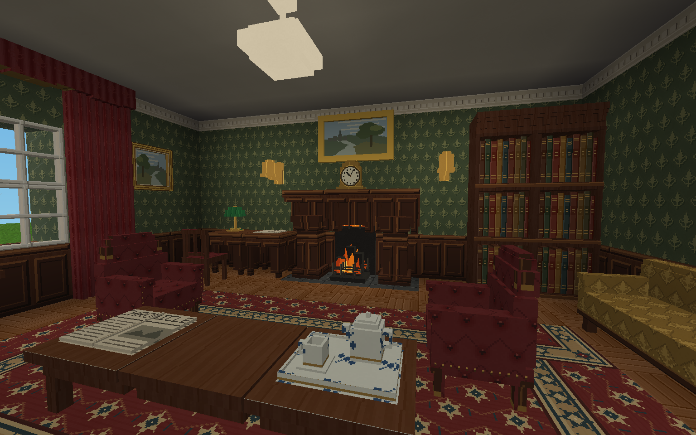
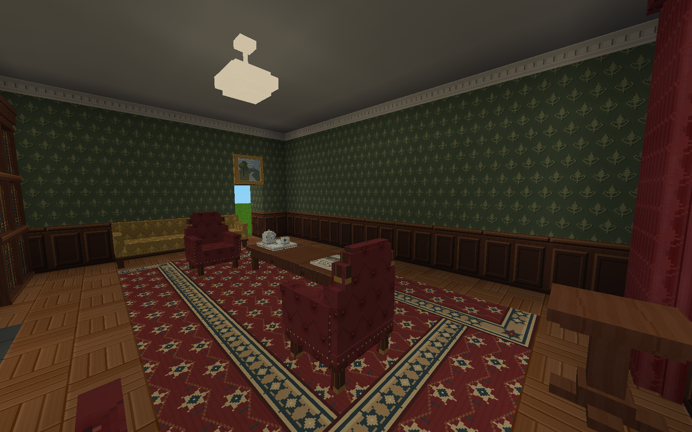

# 221B 会客室参考图复刻

实现提交：`7b0add2a1ae64af66788b3fb09524fc7ddfe1acc`。云端验证：[Actions 41781205226](https://github.com/kikoiio/Wispiva/actions/runs/41781205226)。

以[生成参考图](../../../../docs/references/red-headed-league/baker-sitting-room-reference.png)为目标，在真实 Luanti 产品世界中构造可进入的会客室。文学依据为[《红发会》原文](../../../../docs/source-texts/sherlock-holmes/the-red-headed-league.txt)及 [Sidney Paget 的原始插图](https://commons.wikimedia.org/wiki/File:Redh-02.jpg)；完整房间布局、色彩和装饰属于解释性重建，参考图不是历史照片或游戏截图。

两张 PNG 是 Xvfb 中实际 Luanti 客户端的原始窗口截图，1536×960，未经后期修图。软件 OpenGL 渲染；隐藏人物、悬浮名牌与 HUD，固定两个镜头和正午光照。房间、家具及灯具由正常产品蓝图生成，摄影夹具不增造场景几何。

验证通过：37 项相关 Python 测试、持久化 Lua 检查、25 项既有投影检查和 20 个蓝图出生点的门口／锚点通行断言。正常停服后，启动器核对持久检查点并清除会话标记；同一世界重新启动，回读家具和地毯的名称、朝向及世界时间，再次正常保存。所有本次临时进程已停止。存储后端为 files。摘要及图像 SHA-256 见 [capture-summary.json](capture-summary.json)。

恢复检查曾因零事件的空 Lua 数组编码为 JSON null 而失败，已修复 Python 核验和 Lua 恢复边界。另有 SQLite 检查点回归在修复前报 `product checkpoint is incomplete; recovery marker retained`，修复后通过只读验证、活动状态拒绝和缺字段拒绝；这组 SQLite 证据来自定向测试，本次场景实际使用 files。

此次为单间室内空间和视觉的交付，没有真实模型调用，不构成角色自主行为、家具语义交互、地下空间或整个《红发会》世界完成的证据。外观保留 Luanti 的像素材质及体素几何，与生成参考图不逐像素一致；真人审美验收仍由用户判断。
